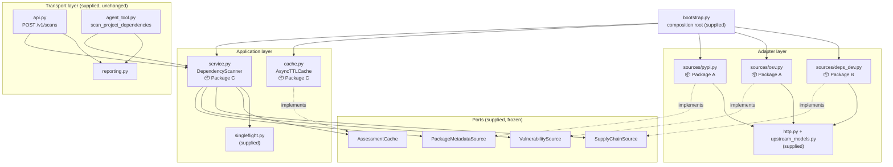
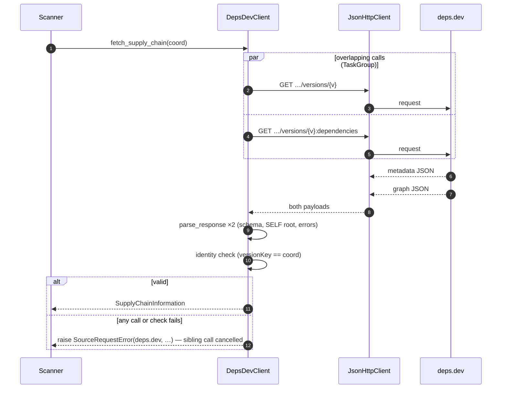
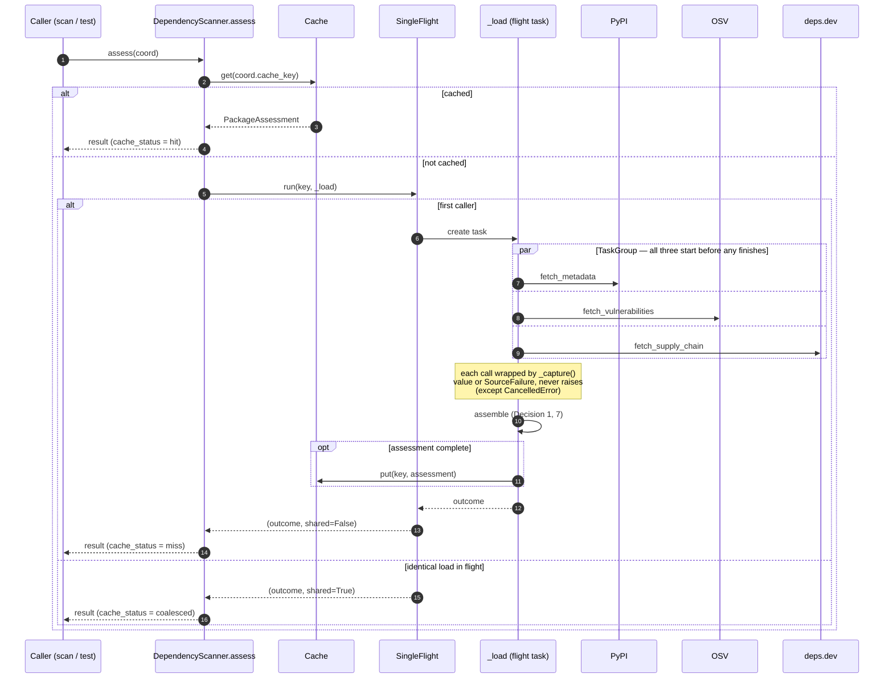
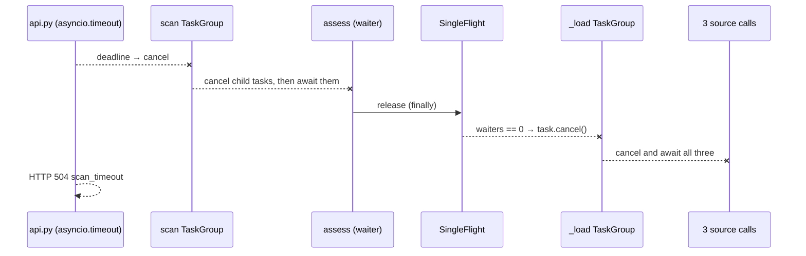

# Design — concurrent dependency intelligence

Status: **Draft for team review**
Inputs: [`requirements.md`](requirements.md) (REQ-*, NFR-*, PRC-*), [`../DECISIONS.md`](../DECISIONS.md)
(Decision 1–11), `SPEC.md` v1.0 (authoritative).

This document fixes **how** the five open seams are built and **how the work is
cut** into three independent packages (A, B, C) plus integration.

---

## 1. Architecture

The supplied code already uses a ports-and-adapters layout. We keep it and only
fill in the five seams. Dependencies point **inwards**: transports → application
→ ports ← adapters. No seam imports another seam.



Key point for parallel work: **the scanner only knows the ports.** It is built
and tested against `tests/fakes.py`, never against the real adapters. The
adapters are built and tested against `httpx.MockTransport` or a fake
`request_json`, never against the scanner. `bootstrap.py` already wires
everything together, so integration needs **no code change**.

---

## 2. Work package split

### 2.1 The cut

| Package                     | Goal                                                                           | Production files (exclusive)                               | Requirements                                                  |
| --------------------------- | ------------------------------------------------------------------------------ | ---------------------------------------------------------- | ------------------------------------------------------------- |
| **A — PyPI & OSV adapters** | Translate PyPI and OSV responses into domain records                           | `sources/pypi.py`, `sources/osv.py`                        | REQ-SRC-01…04, REQ-PYPI-01…03, REQ-OSV-01…04                  |
| **B — deps.dev adapter**    | Two overlapping deps.dev calls → `SupplyChainInformation`, with identity check | `sources/deps_dev.py`                                      | REQ-SRC-01…04, REQ-DEPS-01…07                                 |
| **C — Cache & scanner**     | TTL/LRU cache + concurrent, cancellable, cached orchestration                  | `cache.py`, `service.py`                                   | REQ-FAIL-04…06, REQ-ASM-*, REQ-CON-*, REQ-CACHE-*, REQ-OUT-05 |
| **Integration (merger)**    | Merge A, B, C; quality gate; evidence                                          | `EVIDENCE.md`, `DECISIONS.md`, `spec/merge.md` (structure) | AC-01…10, PRC-06                                              |

### 2.2 Why this cut (independence first)

We compared three ways to cut the work:

| Option | Cut | Cross-package dependency | Verdict |
| --- | --- | --- | --- |
| X | A = all 3 adapters, B = cache, C = scanner | C's contract test `…misses_coalesce` uses the **real** `AsyncTTLCache` → **C consumes B's code**. | Rejected |
| **Y** | **A = PyPI + OSV, B = deps.dev, C = cache + scanner** | **No package consumes another package's code.** Only the combined contract test `test_source_adapters_translate_valid_responses` needs A **and** B merged. | **Chosen** |
| Z | A = adapters, B = cache + scanner, C = test/evidence suite | C cannot prove anything until A and B exist. | Rejected |

Option Y has the following properties:

- **No production file overlap**: each file has exactly one owner.
- **No code dependency**: every package can be finished and verified on its own
  branch from the same base commit.
- **Cohesion**: the cache and its only consumer (cache-status, "only complete
  results are stored") sit in one head, so Decision 6 has one owner.
- **Size is uneven**, which we accept: C is the largest and hardest package, B
  is small but concurrency-sensitive, and A is the simplest.

### 2.3 Frozen interfaces (nobody changes these)

| Interface | Defined in | Used by |
| --- | --- | --- |
| `PackageMetadataSource`, `VulnerabilitySource`, `SupplyChainSource`, `AssessmentCache` | `ports.py` | A, B implement; C consumes |
| `PyPIClient(http, *, base_url)`, `OSVClient(…)`, `DepsDevClient(…)` + `service_name` | `sources/*.py` | `bootstrap.py`, contract tests |
| `AsyncTTLCache(*, ttl_seconds, max_entries, clock)` + `get/put/size` | `cache.py` | `bootstrap.py`, contract tests |
| `DependencyScanner(*, metadata_source, vulnerability_source, supply_chain_source, cache, max_concurrent_packages)` + `scan/assess` | `service.py` | `api.py`, `agent_tool.py`, contract tests |
| Domain records, `SourceRequestError`, `JsonHttpClient.request_json`, `parse_response`, `merge_advisories`, `SingleFlight` | supplied modules | everyone |

Private helpers inside a package's own files are free to add.

---

## 3. Component design

### 3.1 Package A — PyPI adapter (`sources/pypi.py`)

```text
fetch_metadata(coordinate):
    url  = f"{base}/pypi/{quote(coordinate.name, safe='')}/json"      # Decision 8
    data = await http.request_json(PYPI, "GET", url)                    # raises SourceRequestError
    resp = parse_response(PyPIResponse, data, PYPI)                     # invalid → invalid_response
    return PackageMetadata(resp.info.version, resp.info.requires_python)
```

- `PyPIInfo.valid_version` already rejects unparseable versions → REQ-PYPI-03.
- No try/except needed: every failure is already a `SourceRequestError`.

### 3.2 Package A — OSV adapter (`sources/osv.py`)

```text
fetch_vulnerabilities(coordinate):
    body = {"package": {"name": coordinate.name, "ecosystem": "PyPI"},
            "version": coordinate.version}
    data = await http.request_json(OSV, "POST", f"{base}/v1/query", json=body)
    resp = parse_response(OSVResponse, data, OSV)                       # missing vulns → []
    return merge_advisories([Vulnerability(e.id, tuple(e.aliases), e.summary) for e in resp.vulns])
```

- `merge_advisories` already handles transitive alias chains and picks a
  deterministic representative (GHSA/OSV > CVE > other > PYSEC).
- An empty list returns `()`, which is a successful empty answer (REQ-OSV-02).

### 3.3 Package B — deps.dev adapter (`sources/deps_dev.py`)

```text
fetch_supply_chain(coordinate):
    base_path = f"{base}/v3/systems/PYPI/packages/{q(name)}/versions/{q(version)}"   # Decision 8
    run both concurrently in a TaskGroup:
        meta_raw  = request_json(DEPS_DEV, "GET", base_path)
        graph_raw = request_json(DEPS_DEV, "GET", base_path + ":dependencies")
    on ExceptionGroup → re-raise the first SourceRequestError (else re-raise)        # Decision 5
    meta  = parse_response(DepsMetadata, meta_raw,  DEPS_DEV)
    graph = parse_response(DepsGraph,    graph_raw, DEPS_DEV)                        # 1 SELF, no errors
    check meta.version_key and graph.nodes[0].version_key match coordinate           # Decision 4
    return SupplyChainInformation(tuple(meta.licenses),
                                  count(n.relation == "DIRECT"),
                                  meta.published_at)
```



Implementation hints:
- Prefer a plain `except ExceptionGroup as group:` and select the first
  `SourceRequestError` from `group.exceptions` (else re-raise). With
  `except* SourceRequestError`, any *other* exception type in the same group
  stays unhandled and is re-raised as a new `ExceptionGroup`, which the scanner
  would see as `unexpected`. The plain form makes the selection explicit.
- Version identity: `Version(key.version) == Version(coordinate.version)`;
  name identity: `key.coordinate().name == coordinate.name`. Any `ValueError`
  raised by `key.coordinate()` must also become `invalid_response`.

### 3.4 Package C — cache (`cache.py`)

Data structure: `OrderedDict[K, tuple[float, V]]` (expiry deadline, value) plus
one `asyncio.Lock`. The order of the dict is the recency order: the last entry
is the most recently used.

| Operation | Behaviour (under the lock) |
| --- | --- |
| `get(key)` | missing → `None`; `now >= deadline` → delete, `None` (Decision 2); otherwise `move_to_end(key)` (LRU touch, **no** expiry change) and return the value |
| `put(key, value)` | store `(now + ttl, value)`, `move_to_end`; then purge expired entries; then, while `len > max_entries`, `popitem(last=False)` (evict LRU) |
| `size()` | purge expired entries; return `len` |

The clock is read only through the injected `clock()` (monotonic by default).

### 3.5 Package C — scanner (`service.py`)

#### Per-package flow (`assess`)



Building blocks (all private to `service.py`):

| Helper | Responsibility |
| --- | --- |
| `_capture(service, awaitable)` | `await` → `(value, None)`; `SourceRequestError` → `(None, error.failure)`; other `Exception` → `(None, SourceFailure(service, UNEXPECTED, False, f"unexpected {type(e).__name__}"))` (Decision 3). `CancelledError` is a `BaseException` and passes through untouched. |
| `_load(coordinate)` | starts the three `_capture` calls in one `asyncio.TaskGroup`; assembles the outcome; caches it only if complete (Decision 6). Returns `_Outcome(assessment, failures)`. |
| Assembly | `failures` in fixed order PyPI → OSV → deps.dev (Decision 7). All three failed → `assessment = None` (Decision 1); otherwise `PackageAssessment(coord, meta, vulns, supply)`, where a failed part is `None` and an empty answer stays `()`. |
| `_flights: SingleFlight[str, _Outcome]` | one instance per scanner; key = `coordinate.cache_key`. |

#### Project flow (`scan`)

```text
scan(dependencies):
    results: list[DependencyScanResult | None] = [None] * len(dependencies)
    async with TaskGroup() as tg:
        for index, coordinate in enumerate(dependencies):
            tg.create_task(self._assess_into(results, index, coordinate))
    return ProjectScanReport(tuple(results))           # input order (REQ-CON-03)

_assess_into(...):
    async with self._package_limit:                     # Decision 10 + 11
        results[index] = await self.assess(coordinate)
```

- `assess` never raises for source problems (they become failures), so the
  `TaskGroup` only aborts on cancellation, which is exactly what we want.
- **Cancellation** (REQ-CON-05/07, AC-08): when `api.py`'s `asyncio.timeout`
  cancels `scan`, the `TaskGroup` cancels and awaits each `assess`. Each
  `assess` leaves its `SingleFlight`; the last waiter cancels the flight task,
  and the flight's `TaskGroup` then cancels and awaits the three source calls.



#### Concurrency limit scope — Decision 11

`asyncio.Semaphore(max_concurrent_packages)` is created **once per scanner**
in `__init__`, not per `scan()` call. The bootstrap uses one scanner per API
process, so the bound holds across concurrent HTTP requests, which matches
SPEC 1 ("bound concurrency and memory"). See `DECISIONS.md` Decision 11.

---

## 4. Testing strategy

Each package adds **its own test file** (no shared test files) and tags it with
the existing marker so `pytest -m <marker>` picks it up. `pyproject.toml` is not
modified.

| Package | Own test file(s) | Marker | Tests to cover (gaps from requirements §6.2) |
| --- | --- | --- | --- |
| A | `tests/test_task_a_pypi_osv.py` | `sources` | URL/body shape, missing `requires_python`, malformed version → `invalid_response`, missing `vulns` → `()`, `vulns` wrong type → `invalid_response`, 404 → `not_found` attributed to the right service |
| B | `tests/test_task_b_deps_dev.py` | `sources` | `licenses` missing → `()`, missing `nodes` / two `SELF` / node errors → `invalid_response`, `versionKey` mismatch → `invalid_response`, one endpoint 503 → exactly one `deps.dev` failure, sibling cancelled |
| C | `tests/test_task_c_cache.py`, `tests/test_task_c_scanner.py` | `cache`, `orchestration` | LRU touch on `get`, `put` overwrite, concurrent `put`/`get`; unexpected exception mapping without leaking the message, all-fail → `assessment None`, failure order, cancelling `scan()` cancels sources, one cancelled waiter doesn't cancel another's load |

Rules: deterministic only (fakes, `MockTransport`, `FakeClock`, `StartGate`);
no `sleep`-based timing; strict mypy passes on the test files as well.

---

## 5. Integration plan

### 5.1 Branches and base

```text
main ── 86fb537 … (requirements, decisions, design, tasks)
  ├── task-a   (Package A)
  ├── task-b   (Package B)
  └── task-c   (Package C)
```

All three branch from the **same** commit on `main`, the one that adds this
design and the task files.

### 5.2 Merge order and gates

The packages are independent, so any order works. We fix one order so the
expected test state after each step is known:

| Step | Merge | Focused check after merge | Expected full-suite state |
| --- | --- | --- | --- |
| 1 | `task-a` | `uv run pytest tests/test_task_a_pypi_osv.py` | contract translate test still red (needs B) |
| 2 | `task-b` | `uv run pytest -m sources` | **all `sources` green** |
| 3 | `task-c` | `uv run pytest -m "cache or orchestration or transport"` | **all tests green** |
| 4 | — | full quality gate (README) | ruff, format, mypy, pytest all exit 0 |
| 5 | — | runtime evidence (`EVIDENCE.md`) | fixtures + API + tool |

The merger merges one reviewed branch at a time and does **not** start the next
merge until the focused check is green (PRC-06).

### 5.3 Shared-file rules

| File | Owner | Rule for others |
| --- | --- | --- |
| `DECISIONS.md` | Merger | Workers propose new decisions in their `merge.md` section; the merger moves them into `DECISIONS.md`. |
| `EVIDENCE.md` | Merger | Workers may suggest commands in `merge.md`. |
| `spec/merge.md` | Merger (structure) | Each worker edits **only** their own `## Package X` section. |
| `spec/analyze-X.md` | Worker X | Only X edits it. |
| `pyproject.toml`, `uv.lock`, supplied modules, `tests/fakes.py` | nobody | A needed change is proposed in `merge.md`, not made. |
| `SPEC.md`, `tests/test_contract.py`, `checks/readiness.py` | protected | never edited (PRC-01). |

### 5.4 Worker deliverables

1. Code in the owned files only, plus the package's own test file(s).
2. `spec/analyze-X.md` covering: what was built, requirement trace, diagrams
   (Mermaid and/or a sequencediagram.org source block), test evidence, deviations
   and risks. The template is in each task file.
3. The `## Package X` section of `spec/merge.md`: touched files, commits, focused
   check output, proposed decisions, things the merger must watch.
4. Small imperative commits on `task-x`, e.g. `Implement PyPI metadata adapter`.

---

## 6. Risks

| Risk | Impact | Mitigation |
| --- | --- | --- |
| A worker "fixes" a supplied file to make their test pass | merge conflict, scope creep | §5.3 rule: propose in `merge.md`; the merger reviews diffs against owned files |
| `ExceptionGroup` leaks out of deps.dev | scanner maps it to `unexpected` instead of the real kind | Decision 5 + B's own test |
| `CancelledError` swallowed in `_capture` | AC-08 broken (no 504, orphaned calls) | catch `Exception`, never `BaseException`; C's cancellation tests |
| Flight task cancelled but not awaited by `SingleFlight` | a source call may finish its cleanup after `scan` returns | supplied code; sources still observe cancellation (AC-08). Recorded as a known limitation in C's analysis |
| Per-scanner semaphore lets one large request delay others | latency fairness, not correctness | acceptable for the lab; noted in Decision 11 |
| `tool_cli.py` pool not bounded by `MAX_HTTP_CONNECTIONS` | more connections than configured on the CLI path | Decision 9, listed in `EVIDENCE.md` |
