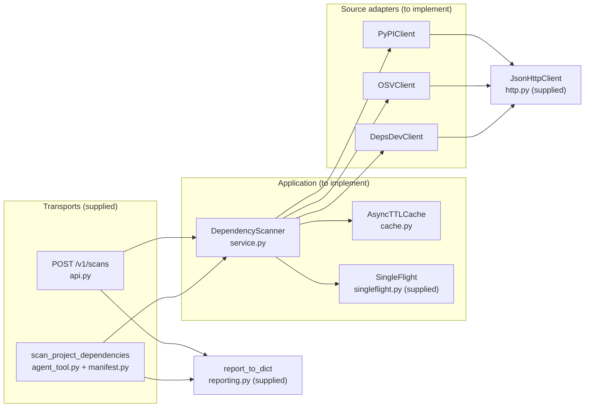

# Requirements — concurrent dependency intelligence

Status: **Agreed 2026-11-18** — open points decided, see `DECISIONS.md`
Derived from: `SPEC.md` v1.0 (authoritative), `AGENTS.md`, `HANDOUT.md`,
`README.md`, `EVIDENCE.md`, `DECISIONS.md`, the public interfaces under `src/`,
and `tests/test_contract.py` / `tests/test_supplied.py`.

> This file distils the sources above. It does **not** replace `SPEC.md`. If the
> two disagree, `SPEC.md` wins and the gap goes to [§9 Open points](#9-open-points-for-discussion).
> Every requirement names its origin so the trace back stays visible.

---

## 1. Goal in one paragraph

Given exact PyPI coordinates (`name==version`), query **PyPI**, **OSV** and
**deps.dev** concurrently, combine their answers into one stable report, stay
useful when a source fails, bound concurrency and memory, and reuse only
**complete** assessments from a process-local cache. One application service
(`DependencyScanner`) powers both the HTTP API and the agent tool.

### 1.1 The components, explained like you're five

Imagine you have a **shopping list of toys** (your project's dependencies). Before
you play with them, you want to know three things about each toy: *is there a
newer one?*, *is it broken or dangerous?*, and *who made it and what's inside?*
Three different **information desks** each know one of those answers.

**The three information desks (external services)**

| Who | ELI5 | What it really is |
| --- | --- | --- |
| **PyPI** | The toy shop catalogue: "the newest version of this toy is 2.0, and it needs batteries of size ≥ 3.10." | Python's package index. Tells us the latest version and the Python version it needs. |
| **OSV** | The safety-recall board: "this toy has a known problem, here is the warning." | The Open Source Vulnerabilities database. Lists known security advisories. |
| **deps.dev** | The ingredients label: "made by X, this licence, released on this date, contains 3 other toys inside." | Google's deps.dev. Gives licences, publish date and the direct dependencies. |
| **Fake upstreams** | Pretend desks made of cardboard that always answer the same way, so tests and demos never surprise us. | `fake_upstreams.py`, a local server that imitates all three on port 8090. |

**The doors you can come in through (transports)**

| Component | ELI5 | What it really is |
| --- | --- | --- |
| **HTTP API** (`api.py`) | The front door: you hand over your list on paper and get a report back. It checks your handwriting first and refuses messy lists. | `POST /v1/scans`. Validates input (422 if bad) and maps the result to HTTP 200, 503 or 504. |
| **Agent tool** (`agent_tool.py`) | The back door for robot helpers: the robot may only read **one** specific list file in **its own room**. It is not allowed to sneak into other rooms. | `scan_project_dependencies`. Reads `requirements.lock` inside a trusted workspace and blocks `../`, absolute paths and symlink escapes. |
| **Manifest parser** (`manifest.py`) | The strict teacher who reads the list file line by line: "toy==exact-number", nothing vague like "any version is fine". | Parses `requirements.lock`. Rejects URLs, extras, wildcards, duplicates and files that are too big. |

**The helpers in the middle (application core)**

| Component | ELI5 | What it really is |
| --- | --- | --- |
| **DependencyScanner** (`service.py`) | The **boss**. For each toy it sends three runners to the three desks **at the same time**, waits for them, and staples the answers together. It never sends more than 8 groups of runners at once, and it keeps the toys in the order you wrote them. | The orchestrator: concurrent source calls, package limit, input order, cancellation, cache use. **To build.** |
| **AsyncTTLCache** (`cache.py`) | A **notebook with a timer**. When all three desks answered, the boss writes the answer down. Next time someone asks about the same toy, the boss reads the notebook instead of running again. Each note expires after 15 minutes, and when the notebook is full, the note nobody looked at for the longest time gets erased. Half-finished answers are **never** written down. | Process-local TTL + LRU cache that stores only complete assessments. **To build.** |
| **SingleFlight** (`singleflight.py`) | The "**I'm already on it!**" rule. If five kids ask about the same toy at the same moment, only one runner goes, and all five get the same answer. If every kid walks away, the runner is called back. | Coalesces identical in-flight loads (`miss` + `coalesced`) and cancels the load when the last waiter leaves. Supplied. |

**The runners (source adapters)**

| Component | ELI5 | What it really is |
| --- | --- | --- |
| **PyPIClient** | Runner to the catalogue desk. Checks that the answer makes sense ("version 2.0", not "version banana"). | `sources/pypi.py`. **To build.** |
| **OSVClient** | Runner to the recall board. If three warnings are really the same problem under different names, it merges them into one. | `sources/osv.py`, which uses the supplied `merge_advisories`. **To build.** |
| **DepsDevClient** | Runner to the ingredients desk. It asks **two** questions (label + contents) at the same time and checks the answer is about the right toy. | `sources/deps_dev.py`, with two overlapping calls and the identity check. **To build.** |

**The toolbox everyone shares (supplied infrastructure)**

| Component | ELI5 | What it really is |
| --- | --- | --- |
| **JsonHttpClient** (`http.py`) | The **telephone** all runners use. If the line is busy it tries once more, it hangs up on people who talk too long (> 1 MB), and it won't accept gibberish. | Bounded HTTP: ≤ 2 attempts, retry on timeout, 429 and 5xx, a size cap, JSON checks, and mapping errors to failure kinds. |
| **Upstream models** (`upstream_models.py`) | The **answer-checking stencils**: if a desk's answer doesn't fit the stencil, it's rejected as "nonsense answer". | Strict pydantic schemas that produce `invalid_response` when a response doesn't match. |
| **Domain** (`domain.py`) | The **official forms** everyone fills in, like "toy name + exact version", "here's what we found", or "this desk failed and here's why". | Immutable records: `DependencyCoordinate`, `PackageAssessment`, `SourceFailure`, `ProjectScanReport`, … |
| **Ports** (`ports.py`) | The **job descriptions**: "a catalogue runner must be able to do *this*". Anyone who fits the description can do the job, including fake runners in tests. | Protocols that the scanner depends on, which let the three work packages be built independently. |
| **Reporting** (`reporting.py`) | The **report-card printer**: turns the stapled answers into the same neat sheet for both doors. | `report_to_dict`, the stable JSON output with summary counts and failures. |
| **Bootstrap** (`bootstrap.py`) | The **person who sets up the room** in the morning: puts the telephone, the notebook and the runners in place and reads the settings. | Composition root that builds everything from environment variables. |

**Two words that matter a lot**

- **`[]` vs `null`**: `[]` means "the recall board said: no problems known". `null`
  means "we couldn't reach the recall board". Those are **not** the same, and the
  second one must never be reported as "safe".
- **complete / partial / failed**: all three desks answered / some answered /
  nobody answered. Only *complete* answers go in the notebook.

## 2. What exists vs. what we build

| Area | File(s) | State |
| --- | --- | --- |
| Domain records, enums, `complete` / `status` semantics | `domain.py` | Supplied |
| Port protocols (sources, cache) | `ports.py` | Supplied — stable interface |
| Typed errors (`SourceRequestError`, `ManifestValidationError`) | `errors.py` | Supplied |
| HTTP retry/size/JSON policy | `http.py` | Supplied |
| Upstream response schemas (pydantic, strict) | `upstream_models.py` | Supplied |
| Advisory alias merge (union-find) | `advisories.py` | Supplied |
| Per-key in-flight coalescing | `singleflight.py` | Supplied |
| Report projection | `reporting.py` | Supplied |
| HTTP API, agent tool, manifest parser, CLI | `api.py`, `agent_tool.py`, `manifest.py`, `tool_cli.py` | Supplied |
| Composition root, settings | `bootstrap.py` | Supplied |
| Deterministic fake upstreams | `fake_upstreams.py` | Supplied |
| **PyPI adapter** | `sources/pypi.py` | **To implement** |
| **OSV adapter** | `sources/osv.py` | **To implement** |
| **deps.dev adapter** | `sources/deps_dev.py` | **To implement** |
| **TTL/LRU cache** | `cache.py` | **To implement** |
| **Scanner orchestration** | `service.py` | **To implement** |

Baseline (commit `a793719`): readiness check passes, 4/4 supplied tests pass,
contract tests 1 pass (agent-tool path escape) / 10 fail on `NotImplementedError`.

---

## 3. Functional requirements

Legend for **State**: `S` = satisfied by supplied code (verify only),
`I` = must be implemented.

### 3.1 Inputs

| ID | Requirement | Origin | State |
| --- | --- | --- | --- |
| REQ-IN-01 | `POST /v1/scans` accepts 1–200 dependencies `{name, version, ecosystem="PyPI"}`; extra fields rejected. | SPEC 3.1 | S (`api.py`) |
| REQ-IN-02 | Only ecosystem `PyPI` (case-insensitive); names must be valid and are normalized (PEP 503); versions must be exact PEP 440. | SPEC 2, 3.1 | S (`domain.DependencyCoordinate`) |
| REQ-IN-03 | Duplicate **normalized** names are rejected. | SPEC 3.1, AC-01 | S (`api.ScanRequest`, `manifest.py`) |
| REQ-IN-04 | Invalid HTTP input → HTTP 422 and **no upstream work**. | SPEC 3.1, AC-01 | S |
| REQ-IN-05 | Agent tool accepts one workspace-relative path whose filename is `requirements.lock`. | SPEC 3.2, AC-09 | S (`agent_tool.py`) |
| REQ-IN-06 | Manifest lines are `name==exact-version`; blank lines and comments allowed; URLs, markers, extras, wildcards, duplicates, invalid UTF-8 rejected. | SPEC 3.2 | S (`manifest.py`) |
| REQ-IN-07 | Absolute paths, hidden/parent components, other filenames and symlinks escaping the workspace are rejected **before** reading or scanning. | SPEC 3.2, AC-09 | S |
| REQ-IN-08 | Manifest ≤ 64,000 bytes and ≤ 200 dependencies; the tool never writes to the workspace. | SPEC 3.2 | S |

### 3.2 Source adapters

Shared rules for all three adapters:

| ID | Requirement | Origin | State |
| --- | --- | --- | --- |
| REQ-SRC-01 | Each adapter performs I/O only through the injected `JsonHttpClient` and uses its configured `base_url`. | AGENTS (I/O in adapters), `sources/*.py` | I |
| REQ-SRC-02 | Each adapter validates the response with the supplied model in `upstream_models.py` via `parse_response(...)`; schema violations become `SourceRequestError(kind=invalid_response, retryable=False)` attributed to that adapter's service. | SPEC 4, AC-02 | I |
| REQ-SRC-03 | Adapters return domain records (`PackageMetadata`, `tuple[Vulnerability, ...]`, `SupplyChainInformation`) or raise `SourceRequestError`. They do not swallow failures or return placeholder "unknown" values. | SPEC 2, 4.1, `ports.py` | I |
| REQ-SRC-04 | Adapters keep the public class names, constructor signatures and `service_name` attributes. | AGENTS (keep public interfaces) | I |

#### PyPI — `PyPIClient.fetch_metadata`

| ID          | Requirement                                                                                                                            | Origin          | State                 |
| ----------- | -------------------------------------------------------------------------------------------------------------------------------------- | --------------- | --------------------- |
| REQ-PYPI-01 | `GET {base}/pypi/{normalized-name}/json`.                                                                                              | SPEC 4.1        | I                     |
| REQ-PYPI-02 | Return `PackageMetadata(latest_version=info.version, requires_python=info.requires_python)`; `requires_python` may be absent → `None`. | SPEC 4.1        | I                     |
| REQ-PYPI-03 | A missing, malformed or unparseable version is `invalid_response`, never a successful unknown value.                                   | SPEC 4.1, AC-02 | I (model enforces it) |

#### OSV — `OSVClient.fetch_vulnerabilities`

| ID | Requirement | Origin | State |
| --- | --- | --- | --- |
| REQ-OSV-01 | `POST {base}/v1/query` with the exact coordinate: `{"package": {"name": <name>, "ecosystem": "PyPI"}, "version": <version>}`. | SPEC 4.2; body shape from `fake_upstreams.py` | I |
| REQ-OSV-02 | An omitted `vulns` field is a successful **empty** answer `()`. | SPEC 4.2 | I (model default) |
| REQ-OSV-03 | Records linked through aliases (also transitively) are merged into one advisory with a deterministic representative; no alias or available summary is lost. | SPEC 4.2, AC-02 | I — use supplied `merge_advisories` |
| REQ-OSV-04 | `vulns` of the wrong type (e.g. a string) → `invalid_response`. | AC-02, fixture `broken-osv-*` | I |

#### deps.dev — `DepsDevClient.fetch_supply_chain`

| ID | Requirement | Origin | State |
| --- | --- | --- | --- |
| REQ-DEPS-01 | Call both `GET {base}/v3/systems/PYPI/packages/{name}/versions/{version}` and `GET …/versions/{version}:dependencies`. | SPEC 4.3; paths from `fake_upstreams.py` | I |
| REQ-DEPS-02 | The two requests are independent and **must overlap**: both start before either finishes. | SPEC 4.3, AC-03 | I |
| REQ-DEPS-03 | Return `licenses` (as a tuple), `published_at` (may be `None`) and `direct_dependency_count` = number of nodes with relation `DIRECT`. | SPEC 4.3 | I |
| REQ-DEPS-04 | The graph has exactly one `SELF` root and no graph-level or node-level errors; otherwise `invalid_response`. | SPEC 4.3 | I (model enforces it) |
| REQ-DEPS-05 | Missing repeated fields (e.g. `licenses`) are valid empty lists; missing required structure (e.g. `nodes`, `versionKey`) is `invalid_response`. | SPEC 4.3 | I (model enforces it) |
| REQ-DEPS-06 | If either call fails, the whole deps.dev source fails with **one** attributed `deps.dev` failure, and the other in-flight call is cancelled rather than leaked. | SPEC 5 (cancel children), SPEC 7 | I — see OP-05 |
| REQ-DEPS-07 | The `versionKey` of the metadata response and of the graph's `SELF` node must match the requested coordinate (normalized name, `Version` equality); a mismatch is `invalid_response`. | SPEC 4.3, AC-02; Decision 4 | I |

### 3.3 Failure behaviour

| ID | Requirement | Origin | State |
| --- | --- | --- | --- |
| REQ-FAIL-01 | Failure kinds are `not_found`, `timeout`, `rate_limited`, `unavailable`, `invalid_response`, `unexpected`. | SPEC 7 | S (`FailureKind`) |
| REQ-FAIL-02 | Every failure names service, kind, retryability, safe detail, and upstream status when available. Never upstream bodies or credentials. | SPEC 7 | S for HTTP-level (`http.py`); I for scanner mapping |
| REQ-FAIL-03 | HTTP policy: ≤ 2 attempts; retries timeouts, transport errors, 429, 500/502/503/504; bounded numeric `Retry-After` (≤ 2 s); ≤ 1 MB identity-encoded body; invalid JSON rejected. | SPEC 7 | S (`http.py`) |
| REQ-FAIL-04 | The scanner converts a `SourceRequestError` into its `.failure`; **any other exception** from a source becomes an `unexpected` failure for that source with a safe, generic detail. | SPEC 7 | I — see OP-03 |
| REQ-FAIL-05 | Cancellation (`asyncio.CancelledError`) is **never** converted into a failure; it propagates. | SPEC 5, AC-08 | I |
| REQ-FAIL-06 | One failed source → partial package assessment that keeps the other successful fields. | SPEC 7, AC-06 | I |

### 3.4 Assessment assembly (one package)

| ID | Requirement | Origin | State |
| --- | --- | --- | --- |
| REQ-ASM-01 | A field is `None` (`null`) **only** when its source failed; a successful empty answer stays `()` / `[]`. | SPEC 2 | I |
| REQ-ASM-02 | A package result is complete only when all three sources succeeded (`DependencyScanResult.complete`). | SPEC 2 | S (domain) + I (set fields correctly) |
| REQ-ASM-03 | When **all three** sources fail for a package, `assessment` is `None`. With any success, `assessment` is a `PackageAssessment` with `None` for the failed parts. | SPEC 2 (`failed` = no useful data), AC-07; `DependencyScanResult.useful` | I — see OP-01 |
| REQ-ASM-04 | `failures` lists one entry per failed source in a deterministic order. | SPEC 8 (stable output) | I — see OP-07 |

### 3.5 Concurrency and cancellation

| ID | Requirement | Origin | State |
| --- | --- | --- | --- |
| REQ-CON-01 | For one uncached package, the PyPI, OSV and deps.dev operations all start before any may finish. | SPEC 5, AC-03 | I |
| REQ-CON-02 | Different packages are scanned concurrently, at most `max_concurrent_packages` at a time (positive, default 8). | SPEC 5, AC-04 | I |
| REQ-CON-03 | `scan()` returns results in **input order**, regardless of completion order. | SPEC 5, AC-04 | I |
| REQ-CON-04 | The shared HTTP connection pool stays bounded by configuration. | SPEC 5 | S (`bootstrap.py` limits) — see OP-09 |
| REQ-CON-05 | Cancelling a scan cancels **and awaits** all outstanding child tasks (no orphans). | SPEC 5, AC-08 | I |
| REQ-CON-06 | Concurrent misses for the same coordinate share **one** in-flight load. | SPEC 5, AC-05 | I — use supplied `SingleFlight` |
| REQ-CON-07 | Cancelling one waiter does not cancel work still needed by another; when the **last** waiter leaves, outstanding source work is cancelled. | SPEC 5, AC-08 | S (`SingleFlight`) + I (the load must propagate cancellation to its 3 source tasks) |

### 3.6 Cache

| ID | Requirement | Origin | State |
| --- | --- | --- | --- |
| REQ-CACHE-01 | Process-local, concurrency-safe async cache with `get`, `put`, `size`. | SPEC 6, `cache.py` | I |
| REQ-CACHE-02 | Uses an injectable **monotonic** clock (default `time.monotonic`). | SPEC 6 | I (constructor supplied) |
| REQ-CACHE-03 | Positive TTL and positive max entry count (validated in constructor). | SPEC 6 | S |
| REQ-CACHE-04 | Expiry is fixed at **insertion**; reads do not extend it. An entry is expired when `now ≥ inserted_at + ttl`. | SPEC 6; test advances by exactly the TTL | I — see OP-02 |
| REQ-CACHE-05 | When capacity is exceeded, evict the **least recently used** entry; a successful `get` counts as a use. | SPEC 6, AC-05 | I |
| REQ-CACHE-06 | `size()` returns the number of live entries after removing expired ones. | `cache.py` docstring | I |
| REQ-CACHE-07 | The cache key contains ecosystem, normalized name and exact version (`DependencyCoordinate.cache_key`). | SPEC 6 | S (key) + I (scanner uses it) |
| REQ-CACHE-08 | Only **complete** assessments are stored. Partial/failed results are never cached, so the next scan calls the missing sources again. | SPEC 6, AC-06, AGENTS | I |
| REQ-CACHE-09 | Each package result reports `miss`, `hit` or `coalesced`: `hit` = served from cache; `miss` = this caller started the load; `coalesced` = joined another caller's in-flight load. | SPEC 6, AC-05 | I |
| REQ-CACHE-10 | A second identical scan in the same process reports hits and makes **no** upstream calls; expired and evicted entries reload. | AC-05 | I |

### 3.7 Output and transport mapping

| ID | Requirement | Origin | State |
| --- | --- | --- | --- |
| REQ-OUT-01 | Report contains `status`, `summary` (total, vulnerable, outdated, failure_count), ordered `dependencies`, flattened `failures`. | SPEC 8 | S (`reporting.py`) |
| REQ-OUT-02 | Project status: `complete` if every result is complete; `partial` if any useful data exists; otherwise `failed`. | SPEC 2 | S (`ProjectScanReport.status`) |
| REQ-OUT-03 | `vulnerable_dependencies` counts packages with ≥ 1 observed advisory; missing OSV data is **not** "safe". | SPEC 8, SPEC 10 | S |
| REQ-OUT-04 | HTTP 200 for complete/partial, 503 for failed. | SPEC 7, AC-06/07 | S (`api.py`) |
| REQ-OUT-05 | Scan deadline → HTTP 504 `{"code": "scan_timeout"}`, scan cancelled, source operations observe cancellation. | SPEC 7, AC-08 | S (`api.py` timeout) + I (scanner must propagate cancellation) |
| REQ-OUT-06 | The agent tool returns the same report shape as the API. | AC-09 | S |

---

## 4. Non-functional requirements

| ID | Requirement | Origin |
| --- | --- | --- |
| NFR-01 | Python 3.12; strict mypy over `src tests checks`. | AGENTS, pyproject |
| NFR-02 | `ruff check` and `ruff format --check` pass (line length 100; rules E, F, I, UP, B, ASYNC). | README, pyproject |
| NFR-03 | Keep public interfaces unchanged (class names, signatures, ports). | AGENTS |
| NFR-04 | External I/O only in adapters; orchestration only in the application service; transport, parsing, orchestration, caching and presentation stay separated. | AGENTS, AC-10 |
| NFR-05 | No new dependencies unless `DECISIONS.md` justifies them. | AGENTS |
| NFR-06 | Acceptance evidence uses deterministic fakes (`tests/fakes.py`, `fake_upstreams.py`), never live services. | AGENTS |
| NFR-07 | No credentials in files, prompts, commits, screenshots or videos. | AGENTS, HANDOUT |
| NFR-08 | Memory bounded: cache capped at `CACHE_MAX_ENTRIES`; responses capped at 1 MB; ≤ 200 deps per request. | SPEC 1, 3, 6, 7 |

Configuration (from `.env.example` / `bootstrap.Settings`): `REQUEST_TIMEOUT_SECONDS=10`,
`SCAN_TIMEOUT_SECONDS=30`, `MAX_CONCURRENT_PACKAGES=8`, `MAX_HTTP_CONNECTIONS=24`,
`CACHE_TTL_SECONDS=900`, `CACHE_MAX_ENTRIES=2000`, plus three base URLs.

## 5. Process requirements

| ID | Requirement | Origin |
| --- | --- | --- |
| PRC-01 | Do not modify `SPEC.md`, `tests/test_contract.py`, `checks/readiness.py`. | AGENTS |
| PRC-02 | Never weaken, delete, skip or rewrite a test assertion to get a pass. | AGENTS |
| PRC-03 | Record each necessary interpretation in `DECISIONS.md` **before** code depends on it (keep the template headings). | AGENTS |
| PRC-04 | Split into tickets first; each ticket has one goal, one owner, explicit file ownership, a focused test command, and a small imperative commit. | AGENTS, HANDOUT |
| PRC-05 | No two active tickets edit the same production file; if unavoidable, make dependency and merge order explicit. | AGENTS |
| PRC-06 | One integrator merges one reviewed commit at a time and runs its focused checks before the next merge. | AGENTS, HANDOUT |
| PRC-07 | Same harness throughout; record environment failures instead of switching. | README, HANDOUT |
| PRC-08 | Deliverables: repo with ticket commits, completed `DECISIONS.md` + `EVIDENCE.md`, one group video. | HANDOUT |

Our team process on top (agreed in chat): `requirements.md` → `design.md` →
`task-A/B/C.md` → `merge.md` (one section per task) → integration by the merger.
Three workers, one merger. Package independence matters more than equal size.

## 6. Verification

### 6.1 Commands

| Purpose | Command |
| --- | --- |
| Readiness | `uv run python checks/readiness.py` |
| Source adapters | `uv run pytest -m sources` |
| Cache | `uv run pytest -m cache` |
| Orchestration | `uv run pytest -m orchestration` |
| Transport | `uv run pytest -m transport` |
| Supplied infrastructure | `uv run pytest -m supplied` |
| Quality gate | `uv run ruff check .` · `uv run ruff format --check .` · `uv run mypy src tests checks` · `uv run pytest` |

### 6.2 Contract tests → requirements → implementation seam

| Test (`tests/test_contract.py`) | Marker | Proves | Seam(s) needed |
| --- | --- | --- | --- |
| `test_source_adapters_translate_valid_responses` | sources | REQ-PYPI-01/02, REQ-OSV-01/03, REQ-DEPS-01/03 | pypi, osv, deps_dev |
| `test_deps_dev_requests_start_concurrently` | sources | REQ-DEPS-02 | deps_dev |
| `test_cache_expires_and_evicts_lru` | cache | REQ-CACHE-04/05/06 | cache |
| `test_three_sources_start_concurrently` | orchestration | REQ-CON-01 | service |
| `test_package_limit_and_order_are_preserved` | orchestration | REQ-CON-02/03 | service |
| `test_partial_result_is_attributed_and_not_cached` | orchestration | REQ-FAIL-06, REQ-ASM-01, REQ-CACHE-08 | service |
| `test_complete_result_is_cached_and_identical_misses_coalesce` | orchestration | REQ-CON-06, REQ-CACHE-09/10 | service **+ cache** |
| `test_cancelling_final_waiter_cancels_sources` | orchestration | REQ-CON-05/07 | service |
| `test_api_maps_complete_and_failed_reports` | transport | REQ-OUT-04, REQ-ASM-03 | service |
| `test_agent_tool_rejects_parent_escape` | transport | REQ-IN-07 | — (already passes) |
| `test_project_report_status_semantics` | transport | REQ-OUT-02 | service |

Not covered by any public test (needs our own tests or runtime evidence):
REQ-PYPI-03, REQ-OSV-04, REQ-DEPS-04/05/06/07, REQ-FAIL-04/05, REQ-CON-05 for
`scan()`, REQ-OUT-05 (deadline/504), REQ-CACHE-01 (concurrency safety).

### 6.3 Runtime evidence required (`EVIDENCE.md`)

| Evidence | How | Requirements |
| --- | --- | --- |
| Source and package calls overlap | timing/start order against `slow-*` fixtures | REQ-CON-01/02, REQ-DEPS-02 |
| Second identical scan served from cache | two identical API calls, compare `GET :8090/_admin/calls` | REQ-CACHE-09/10 |
| Partial failure | scan `unavailable-osv-demo==1.0.0` | REQ-FAIL-06, REQ-ASM-01, REQ-CACHE-08 |
| Agent tool path escape | `../requirements.lock` via tool | REQ-IN-07 |
| Quality gate | four commands above | NFR-01/02 |

Fixture behaviour (`fake_upstreams.py`), by name prefix:
`slow-*` (+2 s), `missing-*` (404), `unavailable-{pypi|osv|deps|deps_graph}-*` (503),
`broken-{pypi|osv|deps}-*` (schema-invalid JSON). Note: a 503 is retried once,
so each unavailable source shows **2** calls per scan in `/_admin/calls`.

## 7. Acceptance criteria → requirements

| AC | Requirements |
| --- | --- |
| AC-01 validated coordinates | REQ-IN-01…08 |
| AC-02 real source adapters | REQ-SRC-*, REQ-PYPI-*, REQ-OSV-*, REQ-DEPS-01/03/04/05/07 |
| AC-03 source concurrency | REQ-CON-01, REQ-DEPS-02 |
| AC-04 package concurrency & order | REQ-CON-02, REQ-CON-03 |
| AC-05 cache & single-flight | REQ-CACHE-*, REQ-CON-06 |
| AC-06 partial failure | REQ-FAIL-06, REQ-ASM-01, REQ-CACHE-08, REQ-OUT-04 |
| AC-07 complete failure | REQ-ASM-03, REQ-OUT-02, REQ-OUT-04 |
| AC-08 deadline & cancellation | REQ-FAIL-05, REQ-CON-05, REQ-CON-07, REQ-OUT-05 |
| AC-09 agent boundary | REQ-IN-05…08, REQ-OUT-06 |
| AC-10 engineering quality | NFR-01…08 |

## 8. Out of scope

From SPEC 10: transitive resolution of unlocked projects; ecosystems other than
PyPI; claiming zero advisories means safe; distributed cache consistency;
authentication or public deployment; a GUI; switching harnesses.
For us also: changes to supplied infrastructure unless a decision justifies it.

---

## 9. Open points — decided

All points were decided on 2026-11-18 and recorded in `DECISIONS.md` as
Decision 1–10 (OP-xx → Decision xx). OP-04 was decided **strict**; all other
proposals were accepted as written.

| ID | Question | Why it matters | Decision |
| --- | --- | --- | --- |
| OP-01 | When all three sources fail, is `assessment` `None` or a `PackageAssessment` with three `None` fields? | `ProjectScanReport.status` uses `useful = assessment is not None`. Three `None` fields would yield `partial` instead of `failed` and break AC-07 (503). | `assessment = None` when no source succeeded. |
| OP-02 | Is an entry still valid at exactly `inserted_at + ttl`? | `test_cache_expires_and_evicts_lru` advances by exactly the TTL and expects a miss. | Expired when `now ≥ inserted_at + ttl`. |
| OP-03 | How should non-`SourceRequestError` exceptions from a source be mapped? | SPEC lists `unexpected` but doesn't define it; a raw exception message could leak upstream data. | `unexpected`, `retryable=False`, generic detail (exception type only, no message), `status_code=None`. |
| OP-04 | Should deps.dev verify that the returned `versionKey` (and `SELF` node) match the requested coordinate? | SPEC is silent; a mismatch would mean wrong data presented as correct. | **Strict**: mismatch → `invalid_response` (REQ-DEPS-07). |
| OP-05 | If one deps.dev call fails, cancel the other? Which failure is reported if both fail? | Must report exactly one `deps.dev` failure; `TaskGroup` wraps errors in `ExceptionGroup`. | Cancel the sibling and report the first `SourceRequestError`. |
| OP-06 | Where is the cache checked relative to single-flight, and what status does a waiter get when the shared load returns a **partial** result? | Defines `hit` / `miss` / `coalesced` exactly; avoids a race where a load finishes between check and join. | Check cache → miss → `SingleFlight.run`; `shared=True` → `coalesced` even for partial results. The flight only writes complete results. |
| OP-07 | Order of `failures` inside one package result. | Stable output (SPEC 8). | Fixed order PyPI → OSV → deps.dev. |
| OP-08 | Should adapters URL-encode name/version in paths? | Normalized names are URL-safe, but local versions can contain `+`. | Percent-encode path segments. |
| OP-09 | `tool_cli.py` builds its `httpx.AsyncClient` without `MAX_HTTP_CONNECTIONS` limits (httpx default: 100). | SPEC 5 wants a pool bounded by configuration; the API path is fine. | Record as a known limitation in supplied code; no change unless the team decides otherwise. |
| OP-10 | Does `scan()` with packages that are already cached still count against the package limit? | Affects throughput only, not correctness. | Yes — simpler: limit wraps the whole `assess()` call. |
