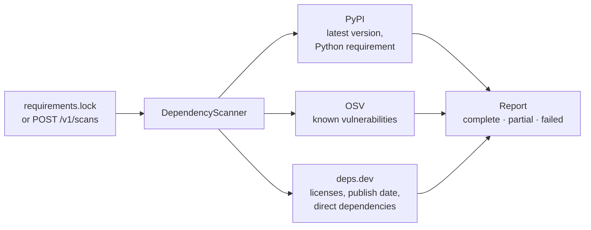
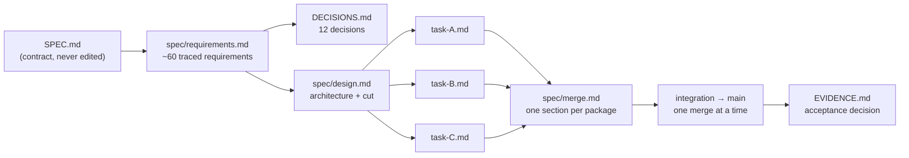
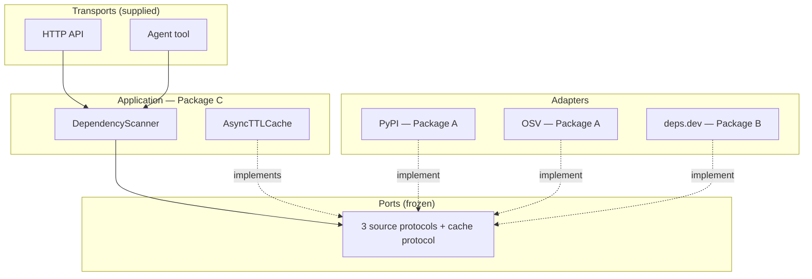
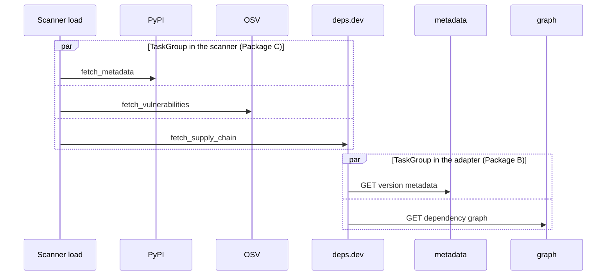
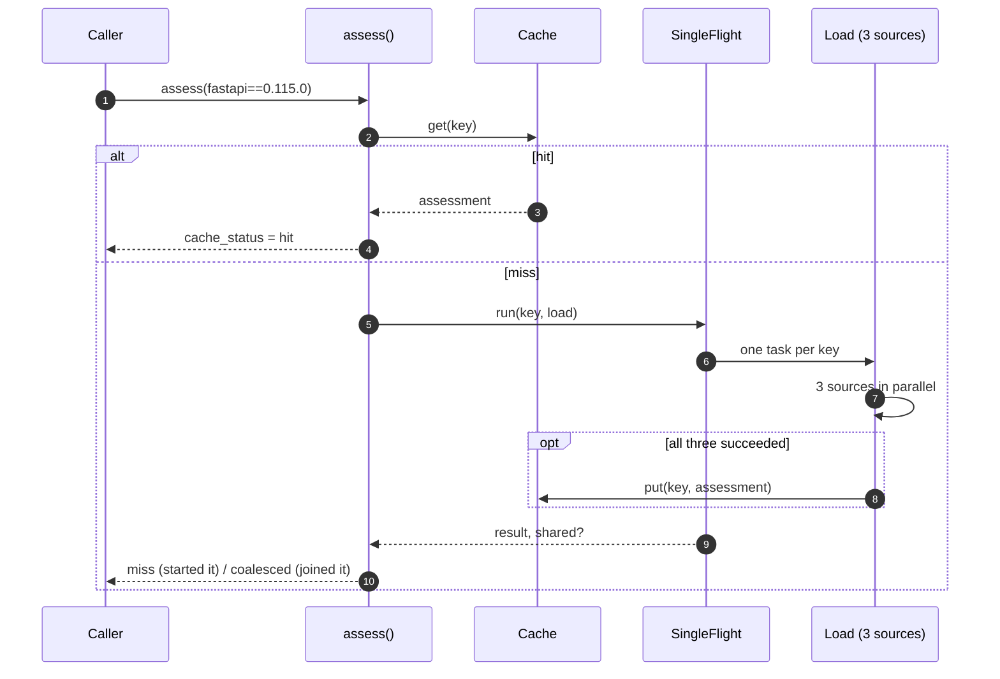
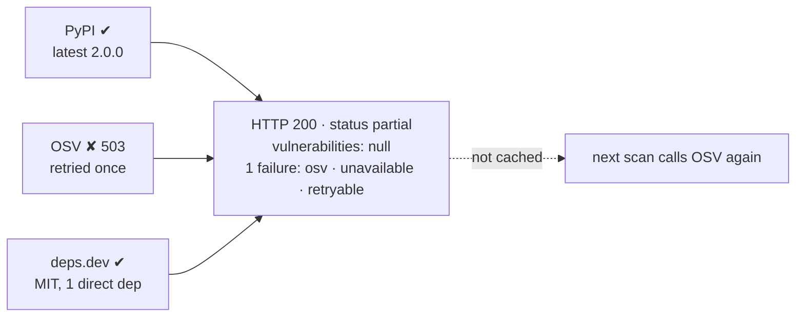

# Concurrent Dependency Intelligence — Lab 03

> Group video · documentation walkthrough
> Narration: `video/script.md` (synthetic voice, Kokoro TTS)

| Role | Person | Package |
| --- | --- | --- |
| Worker | Johann | **A**: PyPI & OSV adapters |
| Worker | Michael | **B**: deps.dev adapter |
| Worker + Merger | Thomas | **C**: cache & scanner · integration |

Repo: `github.com/tho-ple/MSE-AI-LAB-03` · final state `main` (59 tests green)

---

## Scene 1 — The mission

**Input:** exact Python dependencies (`fastapi==0.115.0`)
**Output:** one stable report from three independent sources



- run independent work **concurrently**
- **bound** resource use
- reuse **complete** results from a cache
- stay **useful** when one source fails

---

## Scene 2 — How we worked



- Every interpretation recorded **before** code depended on it
- Each ticket: one goal · one owner · own files · focused check · small commits

---

## Scene 3 — Architecture and the cut



| Option | Cut | Cross-dependency | |
| --- | --- | --- | --- |
| X | adapters / cache / scanner | scanner test needs real cache | ✘ |
| **Y** | **PyPI+OSV / deps.dev / cache+scanner** | **none in code** | ✔ |
| Z | adapters / core / test suite | test suite waits for everyone | ✘ |

**Independence over equal size:** no package imports another package's code.

---

## Scene 4 — Acceptance criterion AC-03: source concurrency

> *All three source operations for one uncached package start before any is
> allowed to finish. The two deps.dev endpoint calls also overlap.*



**Proof by test:** a `StartGate` only releases once *all* calls have started. If
any call were sequential, the test would hang and fail.

**Proof at runtime:** every fixture call sleeps **2 s**; one package = 4 calls.

| Sequential | Measured |
| ---: | ---: |
| 8 s | **2.10 s** |

---

## Scene 5 — Who owns concurrency and the cache



| Concern | Owner in the final design |
| --- | --- |
| package limit | **one semaphore per scanner**: process-wide (Decision 11) |
| identical misses | **SingleFlight**: one load per key |
| 3 sources of one package | **TaskGroup in the load** |
| 2 deps.dev calls | **TaskGroup in the adapter** (Package B) |
| writing the cache | **only the load, only complete results** |
| cancellation | TaskGroups cancel *and await* children; the last waiter cancels the load |

---

## Scene 6 — Cache reuse and a partial failure

### Same request twice

| | 1st request | 2nd request |
| --- | --- | --- |
| HTTP | 200 · 0.246 s | 200 · **0.022 s** |
| cache_status | miss, miss | **hit, hit** |
| upstream calls | `pypi 2 · osv 2 · deps 2 · graph 2` | **unchanged** |

### `unavailable-osv-demo==1.0.0` (OSV returns 503)



| `vulnerabilities: []` | `vulnerabilities: null` |
| --- | --- |
| OSV answered: **no known advisory** | OSV gave **no trustworthy answer** |
| complete, cacheable | partial, **never cached** |

---

## Scene 7 — Quality gate and one meaningful diff

| Command | Exit | Result |
| --- | ---: | --- |
| `ruff check .` | 0 | all checks passed |
| `ruff format --check .` | 0 | 42 files formatted |
| `mypy src tests checks` (strict) | 0 | 30 files, no issues |
| `pytest` | 0 | **59 passed** (starter: 10 failing) |

### Two fixes found in code review

```diff
     try:
         return await operation(), None
+    except asyncio.CancelledError:
+        # propagate only when this task was actually asked to cancel
+        task = asyncio.current_task()
+        if task is None or task.cancelling():
+            raise
+        return None, _unexpected(service, "CancelledError")
     except SourceRequestError as error:
-        return None, error.failure
+        return None, replace(error.failure, service=service)
```

- a **real** cancellation (deadline, cancelled scan) still propagates → HTTP 504
- a source that cancels **itself** becomes one attributed failure → partial report
- the scanner, not the adapter, decides **which source** a failure belongs to

**Tests that check the tests:** we broke the scanner on purpose (catching
every exception, caching partial results, a limit per call, leaking error
text, wrong cancellation handling); each broken variant turns a test red.

---

## Scene 8 — Acceptance decision

### ✔ Accept with stated limitation

| AC | Evidence |
| --- | --- |
| AC-01 validated input | 422, **0** upstream calls |
| AC-02 source adapters | 3 adapters, 25 own tests + contract |
| AC-03 source concurrency | 2.10 s instead of 8 s |
| AC-04 package limit & order | waves of 2 with limit 2; order kept |
| AC-05 cache & single-flight | hit, counters unchanged |
| AC-06 partial failure | 200 · partial · `null` · not cached |
| AC-07 complete failure | 503 · failed · 3 attributed failures |
| AC-08 deadline | 504 `scan_timeout` after 1.03 s |
| AC-09 agent boundary | `../`, absolute path, other filename rejected |
| AC-10 quality | gate green |

### Remaining production risk

> Only **deterministic fixtures** were exercised. The real PyPI, OSV and
> deps.dev APIs may differ: rate limits, or a different version spelling
> hitting our strict identity check (Decision 4).

Also recorded: SingleFlight cancels but does not await a load · shared package
limit can delay small requests · CLI pool not bounded by our setting.

---

## Scene 9 — What we take away

- A **specification trace** made review possible: every line of code points to
  a requirement or a decision.
- **Independence beat equal size:** zero merge conflicts in code.
- **Passing tests were not enough:** overlap, limits and cache reuse only
  became visible with real timing and real call counters.

**Thank you.**
