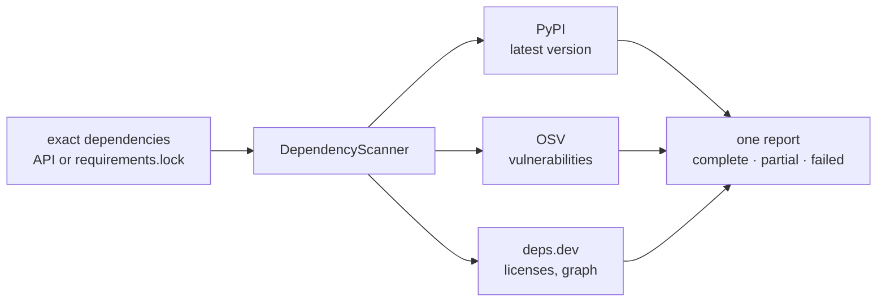
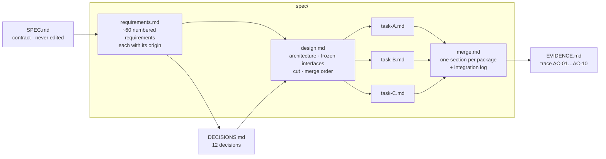
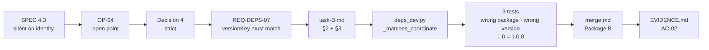
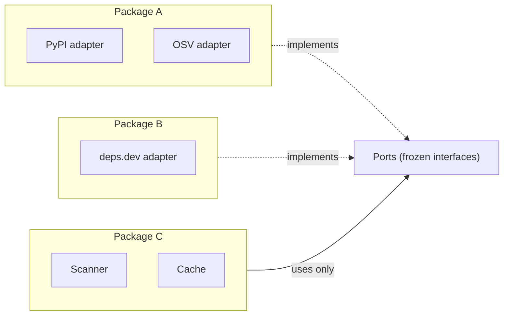
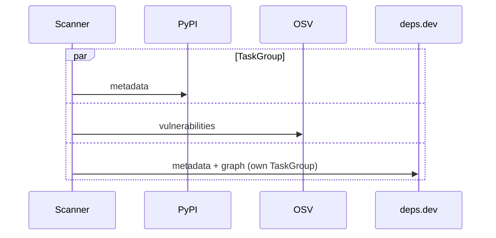
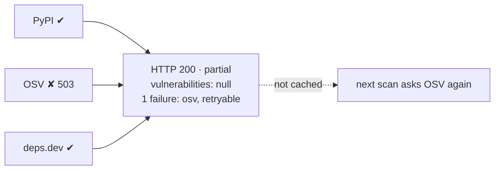

# Concurrent Dependency Intelligence — Lab 03

<!-- Published video (4:23): https://youtu.be/v5zIaBPWbWw -->

> Group video · documentation walkthrough · narration by a synthetic voice (Kokoro TTS)

| Role | Person | Package |
| --- | --- | --- |
| Worker | Johann | **A**: PyPI & OSV adapters |
| Worker | Michael | **B**: deps.dev adapter |
| Worker + Merger | Thomas | **C**: cache & scanner · integration |

---

## Scene 1 — The mission



- concurrent · bounded · cached only when complete · useful when a source fails

---

## Scene 2 — Spec-driven: the `spec/` folder



**Rule:** an open question becomes a recorded decision **before** code depends on it.

---

## Scene 3 — One package = one task file

| Section of `task-B.md` | What it fixes |
| --- | --- |
| header | goal · owner · branch · depends on: nothing · merge order |
| §1 Scope | files you own · read-only references · **must not touch** |
| §2 Requirements | REQ-DEPS-01…07 · Decisions 4, 5, 8 |
| §3 Acceptance | done checklist |
| §4 Tests | 11 test cases to write (B1–B11) |
| §5 Focused check | exact `uv run …` commands |
| §7 Prompt | ready-made prompt for the coding assistant |

Same structure for `task-A.md` and `task-C.md` · each worker writes **only** their
own section of `merge.md`: commits · check output · proposed decisions · what to watch

---

## Scene 4 — One requirement, end to end



Every line of code points back to a requirement, and every requirement to its source.

---

## Scene 5 — The cut: independence over equal size



- No package imports another package's code
- Scanner tested only against fake sources
- Same base commit · **zero code conflicts**

---

## Scene 6 — AC-03: source concurrency

> All three sources start before any may finish; the two deps.dev calls overlap.



| Proof | Result |
| --- | --- |
| Test: `StartGate` opens only when **all** calls started | passes |
| Runtime: 4 calls × 2 s each | **2.10 s** instead of 8 s |

---

## Scene 7 — Who owns concurrency and the cache

| Concern | Single owner |
| --- | --- |
| package limit | one semaphore per scanner (process-wide) |
| identical misses | SingleFlight: one load per key → `miss` / `coalesced` |
| 3 sources of a package | TaskGroup inside that load |
| cache writes | only the load, **only complete results** |
| cancellation | TaskGroups cancel *and await*; last waiter cancels the load |

---

## Scene 8 — Cache reuse and a partial failure

| Same request twice | 1st | 2nd |
| --- | --- | --- |
| cache_status | miss | **hit** |
| time | 0.246 s | **0.022 s** |
| upstream calls | 8 | **+0** |



`[]` = OSV answered, nothing known · `null` = no trustworthy answer

---

## Scene 9 — Quality gate and one diff

| ruff | format | mypy strict | pytest |
| :---: | :---: | :---: | :---: |
| ✔ | ✔ | ✔ | **59 passed** |

**Decision 12, found in code review**

```diff
+    except asyncio.CancelledError:
+        task = asyncio.current_task()
+        if task is None or task.cancelling():
+            raise                                   # real cancellation → 504
+        return None, _unexpected(service, "CancelledError")  # faulty source → partial
```

---

## Scene 10 — Acceptance decision

### ✔ Accept with stated limitation

- AC-01 … AC-10: each has a deterministic test, plus runtime evidence
- 422 before any upstream call · 503 when all fail · 504 at the deadline
- agent tool rejects `../`, absolute paths, other filenames

**Remaining production risk:** only deterministic fixtures were tested. Real
services have rate limits and may spell versions differently than our strict
identity check expects.
